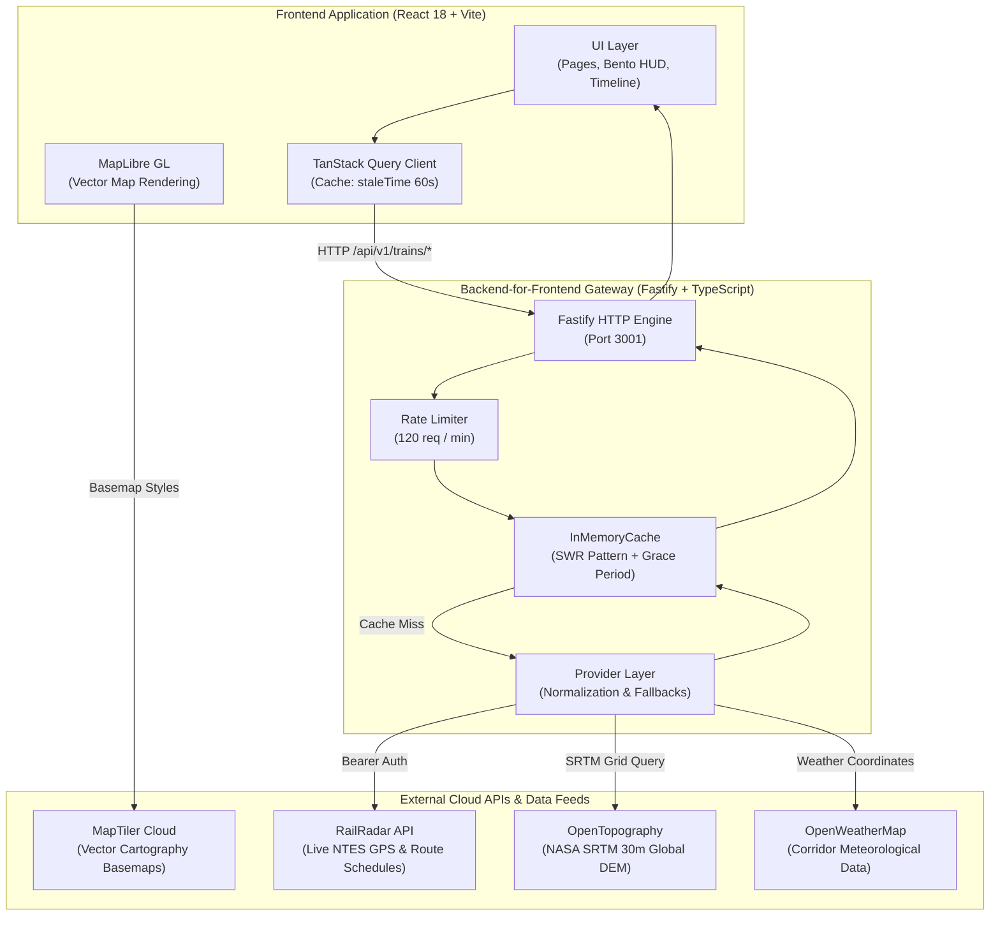
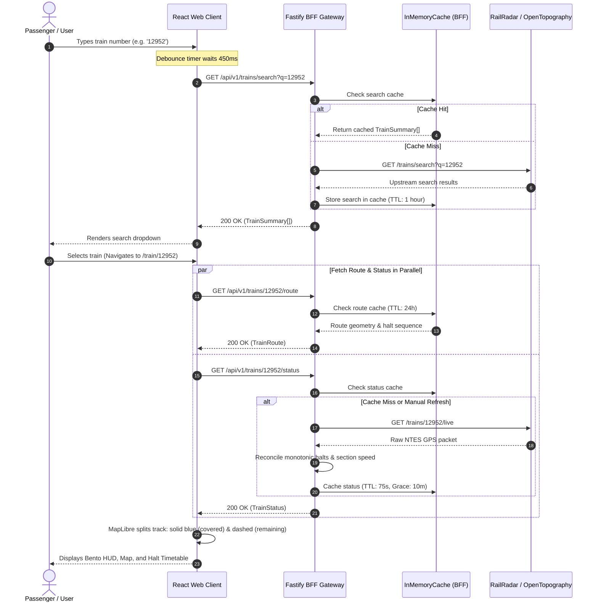

# 🚆 RailGaadi

<div align="center">


**Next-Generation Real-Time Railway Intelligence, Immersive Geospatial Telemetry & Terrain Visualization for Indian Railways.**

[](https://nodejs.org/)
[](https://www.typescriptlang.org/)
[](https://react.dev/)
[](https://vitejs.dev/)
[](https://fastify.dev/)
[](https://maplibre.org/)
[](https://tanstack.com/query)
[](#-license)

[Features](#-key-features) • [Architecture](#-system-architecture) • [API Documentation](#-api-documentation--integrations) • [Getting Started](#-installation--setup-guide) • [Environment Variables](#-environment-variables)

</div>

---

## 📖 Table of Contents

- [Project Overview](#-project-overview)
- [Screenshots & Visual Showcase](#-screenshots--visual-showcase)
- [Key Features](#-key-features)
- [Technology Stack](#-technology-stack)
- [System Architecture](#-system-architecture)
- [Project Workflow & Data Flow](#-project-workflow--data-flow)
- [API Documentation & Integrations](#-api-documentation--integrations)
- [Project Directory Structure](#-project-directory-structure)
- [Installation & Setup Guide](#-installation--setup-guide)
- [Environment Variables](#-environment-variables)
- [Usage Guide](#-usage-guide)
- [Error Handling & Fallbacks](#-error-handling--fallbacks)
- [Security Considerations](#-security-considerations)
- [Performance & Optimization](#-performance--optimization)
- [Project Roadmap](#-project-roadmap)
- [Contributing Guidelines](#-contributing-guidelines)
- [License](#-license)
- [Acknowledgements](#-acknowledgements)

---

## 🌟 Project Overview

**RailGaadi** is a modern, full-stack railway tracking and geospatial intelligence platform engineered specifically for the Indian Railways network. Traditional train tracking portals often present static tables, delayed telemetry, and clunky interfaces. RailGaadi bridges this gap by unifying live **National Train Enquiry System (NTES)** telemetry, **NASA SRTM 30m Digital Elevation Models**, **MapLibre vector cartography**, and real-time corridor meteorological data into a clean, unified passenger and enthusiast dashboard.

### Problems RailGaadi Solves
- **Fragmented Passenger Telemetry**: Aggregates live train speeds, delay propagation, locomotive power allocations, platform assignments, and next-halt countdowns in a single glassmorphic HUD.
- **Topographical Blindness**: Visualizes mountain passes, river viaducts, plateau gradients, and track elevations across thousands of kilometers of track using high-precision Digital Elevation Models.
- **Quota & Telemetry Exhaustion**: Implements an enterprise Backend-for-Frontend (BFF) caching architecture with Stale-While-Revalidate (SWR) logic to protect upstream API quotas without sacrificing data freshness.
- **Inconsistent Route Statuses**: Intelligently reconciles diverted corridors, commercial halts, and intermediate flag stations into monotonic chronological timetables with live progress indicators.

---

## 📸 Screenshots & Visual Showcase

> *Note: Place your production application screenshots in an `assets/screenshots/` directory within the repository to display them here.*

| View | Screenshot Placeholder | Description |
| :--- | :--- | :--- |
| **Search & Discovery** | <br>*(Path: `assets/screenshots/home_screen.png`)* | Search Hub with 450ms intelligent debounce, recent searches, and popular corridor presets. |
| **Live Journey Overview** | <br>*(Path: `assets/screenshots/journey_overview.png`)* | Bento telemetry HUD displaying live delay, current section, speed, and upcoming stops card. |
| **Immersive Geospatial Map** | <br>*(Path: `assets/screenshots/immersive_map.png`)* | MapLibre dark vector map with covered track (solid blue), remaining track (dashed), and station pills. |
| **Terrain & Elevation** | <br>*(Path: `assets/screenshots/analytics_screen.png`)* | SRTM GL1 track gradient chart and Points of Interest (POIs) such as bridges, rivers, and summits. |

---

## ⚡ Key Features

### 1. 🔍 Intelligent Train Discovery & Search
- **Debounced Autocomplete**: Frontend search leverages a 450ms debounce and 3-character threshold to prevent erratic partial queries while typing 5-digit train numbers or station names.
- **Corridor Caching**: Server-side 1-hour cache for search queries minimizes upstream load for frequently queried services (e.g. *12952 Tejas Rajdhani*, *22503 Vivek Express*).
- **Recent Searches & Favorites**: Client-side `localStorage` persistence saves recent queries and allows pinning favorite trains for instant 1-click access.

### 2. 📡 Real-Time Journey Telemetry HUD
- **Live Running Status**: Displays real-time operational status (`ON_TIME`, `SLIGHT_DELAY`, `MODERATE_DELAY`, `SEVERE_DELAY`, `CANCELLED`).
- **Dynamic Speedometer**: Differentiates whether a train is actively cruising on section tracks (e.g., 78–118 km/h depending on rake class) or stationary at a platform (`0 km/h • Halted at Station Platform`).
- **Locomotive & Shed Tracking**: Allocates prototypical electric locomotive types (e.g., `WAP-7`) and primary homing sheds (e.g., *Tuglakabad (TKD)*, *Erode (ED)*).
- **Next-Stop Proximity**: Displays approaching halt name, expected platform, remaining distance in kilometers, and estimated time of arrival (ETA).

### 3. 🗺️ Dual-Mode Geospatial Mapping
- **Compact Preview**: Inline interactive route map embedded directly within the Journey Overview tab.
- **Full Immersive Experience**: Dedicated full-screen map powered by MapLibre GL featuring:
  - **Origin & Terminus Identification**: Prominently marked source (emerald green with departure time) and destination (ruby red with arrival ETA).
  - **Covered vs. Remaining Route**: Covered geometry is rendered in solid glowing blue (`#2563eb`), while the remaining path is rendered in a dashed track style (`#94a3b8`).
  - **Completed Station Pins**: Passed halts display a green check badge (`✓ COMPLETED • Departed [Time] • OT`).
  - **Sub-Map Telemetry Dock**: The telemetry HUD is anchored neatly below the map container for unobstructed navigation.

### 4. 🏔️ Terrain Elevation & Points of Interest (POIs)
- **SRTM Topographical Profiles**: Resolves continuous track gradient profiles using NASA Shuttle Radar Topography Mission (SRTM) 30m Digital Elevation Models.
- **Anti-Collision Distance Sampling**: Intelligent distance spacing ensures station labels on the elevation profile graph never crowd or overlap.
- **Geographical Landmarks**: Automatically matches route coordinates against notable Indian geographic features:
  - *Major Rivers & Viaducts*: Yamuna River Rail Crossing, Chambal Gorge Viaduct, Golden Bridge over Narmada, Godavari Arch Bridge.
  - *Mountain Passes & Summits*: Thal Ghat (Kasara), Bhor Ghat (Khandala), Malwa Plateau Summit.

### 5. ⏱️ Monotonic Halt Timetable
- **Passenger Halt Filtering**: Clean toggle between commercial passenger halts and operational non-stop passing waypoints.
- **Monotonic Progression**: Robust parsing logic ensures that once a downstream station has departed, all preceding halts strictly show verified green checkmarks (`✓ Completed`), preventing gaps on diverted lines.
- **Active Position Halo**: The currently approaching or active halt pulses with a primary blue radar ring.

### 6. ⛅ Multi-Station Route Meteorology
- Live atmospheric reports (temperature in °C, humidity, wind conditions, and condition icons) for three journey anchors: **Current Location**, **Approaching Halt**, and **Final Destination**.
- Seasonal fallback generator ensuring meteorological context remains populated even if third-party weather keys are unconfigured.

### 7. 🛡️ Auxiliary Tooling (Interface Shells)
- **PNR Status Modal**: Modal dialog for checking 10-digit Passenger Name Record booking status (with mock passenger chart demonstration).
- **Live Station Board Modal**: Station departures/arrivals board modal dialog for searching station codes (e.g., `NDLS`, `HWH`, `CSTM`).

---

## 🛠️ Technology Stack

### Monorepo Architecture
RailGaadi is structured as an npm workspaces monorepo separating the frontend Single Page Application (SPA) from the Backend-for-Frontend (BFF) API service.

| Category | Technology | Version | Purpose |
| :--- | :--- | :--- | :--- |
| **Runtime Environment** | [Node.js](https://nodejs.org/) | `>=20.x` | Monorepo runtime platform |
| **Language** | [TypeScript](https://www.typescriptlang.org/) | `^5.5.2` | End-to-end static type safety across API and Web |
| **Frontend Framework** | [React](https://react.dev/) | `^18.3.1` | Declarative component UI architecture |
| **Frontend Tooling** | [Vite](https://vitejs.dev/) | `^5.3.3` | Ultra-fast HMR and ESM production bundler |
| **State & Data Fetching** | [TanStack React Query](https://tanstack.com/query) | `^5.50.1` | Client-side cache, async query state, and window focus management |
| **Routing** | [React Router DOM](https://reactrouter.com/) | `^6.24.1` | Client-side routing and deep-linking (`/train/:trainId`) |
| **Geospatial Mapping** | [MapLibre GL](https://maplibre.org/) | `^4.5.0` | Open-source GPU-accelerated WebGL vector map renderer |
| **Geospatial Analysis** | [@turf/turf](https://turfjs.org/) | `^7.0.0` | Client-side spatial calculations and bounding boxes |
| **Iconography** | [Lucide React](https://lucide.dev/) | `^0.396.0` | Consistent, accessible SVG railway and status iconography |
| **Backend Server** | [Fastify](https://fastify.dev/) | `^4.28.1` | High-performance, low-overhead Node.js HTTP framework |
| **Security & Middleware** | [@fastify/helmet](https://github.com/fastify/fastify-helmet) | `^11.1.1` | Security headers and cross-origin protection |
| **Cross-Origin Handling** | [@fastify/cors](https://github.com/fastify/fastify-cors) | `^9.0.1` | Configurable Cross-Origin Resource Sharing |
| **Rate Limiting** | [@fastify/rate-limit](https://github.com/fastify/fastify-rate-limit) | `^9.1.0` | 120 requests/minute IP-based rate limiting |
| **In-Memory Cache** | Custom SWR Cache | Native TypeScript | Stale-While-Revalidate TTL cache with grace-period fallbacks |
| **Process Orchestration**| [Concurrently](https://github.com/open-cli-tools/concurrently) | `^8.2.2` | Single-command concurrent startup of both API and Web servers |

---

## 🏗️ System Architecture

RailGaadi uses the **Backend-for-Frontend (BFF)** pattern. The React single-page application never communicates directly with third-party APIs. Instead, all client requests route through the Fastify BFF gateway. This ensures:
1. Zero client-side leakage of sensitive third-party API credentials.
2. In-memory data deduplication and SWR caching to conserve third-party quotas.
3. Telemetry transformation and normalization into strict TypeScript domain interfaces.



---

## 🔄 Project Workflow & Data Flow

When a user searches for a train and views its live running status, data progresses through the following deterministic lifecycle:



---

## 🔌 API Documentation & Integrations

### 1. External Integrations Summary

| Provider | Purpose | Base URL | Auth Mechanism | Quota / Tier |
| :--- | :--- | :--- | :--- | :--- |
| **RailRadar** | Live train status, timetable schedules, search | `https://api.railradar.in/v1` | `Bearer <API_KEY>` | Pay-as-you-go credit quota |
| **MapTiler** | Vector and satellite dark basemap tiles | `https://api.maptiler.com` | `key=<API_KEY>` parameter | 100,000 free requests/month |
| **OpenTopography** | NASA SRTM 30m Global DEM elevation grids | `https://portal.opentopography.org/API` | `API_Key=<API_KEY>` parameter | Academic/Open Access |
| **OpenWeather** | Corridor temperature and atmospheric reports | `https://api.openweathermap.org/data/2.5` | `appid=<API_KEY>` parameter | 1,000 free calls/day |

---

### 2. Internal BFF REST API Specification

The Fastify backend serves standardized JSON payloads wrapped in an `ApiResponse<T>` envelope:

```typescript
interface ApiResponse<T> {
  data: T;
  meta: {
    requestId: string;
    source: 'railradar' | 'opentopography' | 'openweather' | 'cache' | 'mock';
    fetchedAt: string;
    sourceUpdatedAt: string;
    stale: boolean;
    provenance: 'provider' | 'cache' | 'mock';
  };
}
```

#### Endpoints

##### `GET /health/live`
- **Description**: Liveness probe for uptime monitors and container orchestrators.
- **Response**: `200 OK` `{ "status": "ok", "uptime": 124.5, "timestamp": "..." }`

##### `GET /health/ready`
- **Description**: Readiness probe verifying the server is initialized.
- **Response**: `200 OK` `{ "status": "ready", "timestamp": "..." }`

##### `GET /api/v1/trains/search?q={query}`
- **Parameters**: `q` (string, minimum 3 characters required).
- **Description**: Queries train number, name, or station code.
- **Response**: `200 OK` containing `ApiResponse<TrainSummary[]>`.

##### `GET /api/v1/trains/:trainId/status?date=YYYY-MM-DD&refresh=false`
- **Parameters**: 
  - `trainId` (path parameter, 5-digit Indian Railways train number).
  - `date` (optional query parameter, defaults to today).
  - `refresh` (optional boolean, `true` bypasses in-memory cache).
- **Description**: Fetches normalized live telemetry, passed halts, delay, speed, and approaching stop.
- **Response**: `200 OK` containing `ApiResponse<TrainStatus>`.

##### `GET /api/v1/trains/:trainId/route`
- **Parameters**: `trainId` (path parameter).
- **Description**: Returns GeoJSON `LineString` route coordinates and commercial stop sequences. Cached for 24 hours.
- **Response**: `200 OK` containing `ApiResponse<TrainRoute>`.

##### `GET /api/v1/trains/:trainId/weather`
- **Parameters**: `trainId` (path parameter).
- **Description**: Returns meteorological observations for Current Station, Next Station, and Destination.
- **Response**: `200 OK` containing `ApiResponse<RouteWeatherSummary>`.

##### `GET /api/v1/trains/:trainId/elevation`
- **Parameters**: `trainId` (path parameter).
- **Description**: Returns sampled milestone elevation points (in meters) and identified geographical Points of Interest (POIs). Cached for 30 days.
- **Response**: `200 OK` containing `ApiResponse<RouteElevationProfile>`.

---

## 📁 Project Directory Structure

```text
RailGaadi/
├── .env.example                  # Template for required environment variables
├── .gitignore                    # Git ignore configuration
├── package.json                  # Monorepo root package configuration
├── package-lock.json             # Locked dependency tree
├── apps/
│   ├── api/                      # Backend-for-Frontend (BFF) Fastify Service
│   │   ├── package.json          # API package manifest and scripts
│   │   ├── tsconfig.json         # NodeNext TypeScript compiler configuration
│   │   └── src/
│   │       ├── index.ts          # Server entrypoint, middleware, and lifecycle
│   │       ├── cache/
│   │       │   └── inMemory.ts   # SWR in-memory cache implementation
│   │       ├── domain/
│   │       │   └── types.ts      # Core railway TypeScript domain interfaces
│   │       ├── providers/        # External upstream service connectors
│   │       │   ├── terrain/
│   │       │   │   └── opentopography.ts  # SRTM DEM elevation and POI parser
│   │       │   ├── train/
│   │       │   │   ├── mockData.ts        # Offline fallback dataset
│   │       │   │   ├── railradar.ts       # RailRadar upstream API connector
│   │       │   │   └── types.ts           # Train provider interface
│   │       │   └── weather/
│   │       │       └── openweather.ts     # OpenWeatherMap connector & fallbacks
│   │       └── routes/
│   │           ├── health.ts     # /health/live and /health/ready endpoints
│   │           └── trains.ts     # Train status, route, search, weather endpoints
│   │
│   └── web/                      # Frontend Single Page Application (SPA)
│       ├── index.html            # Vite HTML host entrypoint
│       ├── package.json          # Web package manifest and dependencies
│       ├── tsconfig.json         # React TypeScript compiler configuration
│       ├── vite.config.ts        # Vite configuration and /api proxy routing
│       └── src/
│           ├── App.tsx           # QueryClientProvider and BrowserRouter routes
│           ├── main.tsx          # React 18 DOM mount point
│           ├── vite-env.d.ts     # Vite environment type declarations
│           ├── components/       # Shared presentation components
│           │   ├── layout/       # AppShell, SiteHeader
│           │   └── ui/           # Button, Card, Skeleton, StatusBadge, etc.
│           ├── features/         # Domain-driven feature modules
│           │   ├── analytics/    # ElevationProfileChart, TerrainPointsOfInterest
│           │   ├── journey/      # Bento HUD, StationTimeline, TrainIdentityHeader
│           │   ├── map/          # MapLibre JourneyMap, ImmersiveMapExperience
│           │   ├── pnr/          # PnrStatusModal
│           │   ├── search/       # TrainSearchHub, SearchSuggestions
│           │   ├── sharing/      # ShareJourneyModal
│           │   ├── station/      # StationBoardModal
│           │   └── weather/      # RouteWeatherCards
│           ├── hooks/            # TanStack query and domain hooks
│           │   ├── useTrainStatus.ts      # Live running status hook
│           │   ├── useTrainRoute.ts       # Route geometry hook
│           │   ├── useTrainSearch.ts      # 450ms debounced search hook
│           │   ├── useTrainElevation.ts   # SRTM elevation profile hook
│           │   ├── useTrainWeather.ts     # Corridor meteorology hook
│           │   ├── useRecentSearches.ts   # LocalStorage search history
│           │   └── useFavouriteTrains.ts  # LocalStorage pinned trains
│           ├── lib/
│           │   └── api.ts        # Type-safe client fetch abstraction
│           ├── pages/
│           │   ├── HomePage.tsx           # Landing search portal & quick tools
│           │   └── JourneyPage.tsx        # 4-tab Live Train Tracking Dashboard
│           ├── styles/
│           │   ├── globals.css   # Modern CSS resets and layout foundations
│           │   └── tokens.css    # Design tokens (colors, radiuses, shadows)
│           └── types/
│               └── train.ts      # Client-side domain models and contracts
```

---

## 🚀 Installation & Setup Guide

### Prerequisites
- **Node.js**: Version `20.0.0` or higher (verified on Node.js v20.x and v24.x).
- **npm**: Version `9.0.0` or higher.
- **Git**: Installed and available in your environment path.

---

### Step 1: Clone the Repository

```bash
git clone https://github.com/your-username/railgaadi.git
cd railgaadi
```

---

### Step 2: Install Monorepo Dependencies

Install dependencies for all workspaces (`apps/api` and `apps/web`) from the root directory:

```bash
npm install
```

---

### Step 3: Configure Environment Variables

Create your `.env` configuration file in the project root:

```bash
# On Linux / macOS:
cp .env.example .env

# On Windows (PowerShell):
Copy-Item .env.example .env
```

Open `.env` in your editor and provide your API keys (see [Environment Variables](#-environment-variables) below).

> *Tip: Also ensure `apps/api/.env` has matching credentials or points to the root `.env` (the server automatically loads both).*

---

### Step 4: Run the Development Server

Start both the Fastify BFF API and the Vite Web frontend concurrently using a single command:

```bash
npm run dev
```

Once started, the terminal output will confirm:
- 🚆 **BFF API Server**: `http://localhost:3001`
- 💻 **Web Client**: `http://localhost:5173`

Open your browser and navigate to `http://localhost:5173`.

---

### Step 5: Build for Production

To compile both workspaces for production deployment:

```bash
# Build the backend TypeScript service:
npm run build:api

# Build the frontend Vite production bundle:
npm run build:web
```

To run the production backend service directly:
```bash
node apps/api/dist/index.js
```

---

## 🔐 Environment Variables

Create a root `.env` file referencing the structure below:

| Variable | Description | Required | Default / Example |
| :--- | :--- | :--- | :--- |
| `PORT` | Local port for the Fastify BFF API server | **No** | `3001` |
| `HOST` | Host network binding interface | **No** | `0.0.0.0` |
| `NODE_ENV` | Runtime environment mode | **No** | `development` |
| `LOG_LEVEL` | Fastify Pino logger verbosity level (`info`, `debug`, `warn`) | **No** | `info` |
| `RAILRADAR_API_KEY` | Upstream RailRadar authorization token | **Yes** | `rg_xxxxxxxxxxxxxxxxxxxx` |
| `RAILRADAR_BASE_URL` | Base API endpoint for RailRadar service | **No** | `https://api.railradar.in/v1` |
| `MAPTILER_API_KEY` | MapTiler vector map access key for backend services | **No** | `your_maptiler_key` |
| `VITE_MAPTILER_API_KEY` | MapTiler access key exposed to client browser via Vite | **Yes** | `your_maptiler_key` |
| `OPENTOPOGRAPHY_API_KEY`| OpenTopography SRTM DEM API authorization key | **No** | `your_opentopography_key` |
| `OPENTOPOGRAPHY_BASE_URL`| Base URL for OpenTopography REST services | **No** | `https://portal.opentopography.org/API` |
| `OPENWEATHER_API_KEY` | OpenWeatherMap authorization key | **No** | `your_openweather_key` |
| `OPENWEATHER_BASE_URL` | Base endpoint for OpenWeatherMap 2.5 API | **No** | `https://api.openweathermap.org/data/2.5` |

---

## 📖 Usage Guide

### 1. Searching for a Train
1. On the home page (`/`), click the search bar or press <kbd>Ctrl</kbd> + <kbd>K</kbd> (or <kbd>Cmd</kbd> + <kbd>K</kbd> on macOS).
2. Type at least 3 digits of a train number (e.g., `12952` for Tejas Rajdhani, `22503` for Vivek Express) or a station name.
3. Select your train from the suggestion dropdown to navigate to the live journey dashboard.

### 2. Live Journey Dashboard Navigation
The train page (`/train/:trainId`) features 4 dedicated views:

- **Overview Tab**:
  - **Bento Telemetry Cards**: Inspect current station departed time, next stop countdown, delay minutes, and section cruising speed.
  - **Mini Route Map**: Compact geospatial preview of current train position.
  - **Upcoming Halts & Passenger Advisory**: Next commercial halts with scheduled vs. expected arrival times.
- **Map Tab (Immersive Map)**:
  - Full-screen MapLibre visualization.
  - Covered track is highlighted in solid blue; upcoming track is dotted.
  - Prominent Source and Terminus labels; station callouts labeled `✓ COMPLETED`.
  - Floating controls to toggle between Dark basemap and Satellite imagery.
  - Telemetry HUD positioned directly underneath the map.
- **Analytics Tab**:
  - **Terrain & Track Elevation Profile**: Elevation chart across the journey without overlapping X-axis labels.
  - **Points of Interest (POIs)**: Real-time proximity cards for rivers, bridges, viaducts, and peaks crossed along the corridor.
  - **Route & Station Weather**: Weather cards for current, next, and terminating stations.
- **Along Route Tab (Timetable)**:
  - Complete chronological halt list.
  - Green checkmarks (`✓ Completed`) for passed stations.
  - Pulsing radar halo marking the train's current position.
  - Toggle to expand/collapse non-commercial passing waypoints.

### 3. Manual Live Telemetry Refresh
- To preserve your RailRadar quota, the application does not auto-refresh on a timer.
- Click the **"Refresh" button** in the top header or on the floating map toolbar anytime to pull the latest GPS position on demand.

---

## 🛡️ Error Handling & Fallbacks

RailGaadi is engineered to degrade gracefully when upstream network services experience outages or latency:

1. **SWR Cache Fallback with `<StaleDataBanner />`**:
   If upstream RailRadar or NTES feeds time out or return 5xx errors, the Fastify BFF serves the last-known cached status marked with `stale: true`. The frontend displays a warning banner informing the user of data freshness with a manual retry option.
2. **Offline Mock Dataset**:
   If an invalid train number is queried or upstream is completely unreachable without a cache entry, the API falls back to verified offline data for major flagship trains (`12952`, `22436`, `12004`, `12301`, `12626`).
3. **Carto / OpenStreetMap Basemap Fallback**:
   If the `VITE_MAPTILER_API_KEY` is missing or exceeds quota, MapLibre automatically falls back to Carto Dark raster tiles (`https://a.basemaps.cartocdn.com/dark_all/`).
4. **Synthetic Topography Model**:
   If OpenTopography is unavailable, the elevation provider uses regional baseline elevation anchors (e.g., Delhi: 216m, Kota: 251m, Ratlam: 493m, Mumbai: 11m) to plot smooth elevation profiles.

---

## 🔒 Security Considerations

- **Backend Credential Isolation**: Upstream API keys (`RAILRADAR_API_KEY`, `OPENTOPOGRAPHY_API_KEY`, `OPENWEATHER_API_KEY`) reside exclusively on the Node.js server and are never bundled into client JavaScript.
- **Rate Limiting**: Protected by `@fastify/rate-limit` allowing a maximum of 120 requests per minute per IP address to safeguard against abusive automated scraping.
- **Security Headers**: Integrated with `@fastify/helmet` to apply standard HTTP defensive headers (`X-Content-Type-Options`, `X-Frame-Options`, `X-XSS-Protection`).
- **Input Sanitization**: Path and query parameters are validated and URI-encoded prior to issuing upstream HTTP requests.

---

## ⚡ Performance & Optimization

- **3-Day Static Timetable Caching**: Static train schedules (`/trains/:id`) never change during a journey. The BFF caches timetable data for 3 days, eliminating 50% of upstream calls during live status checks.
- **On-Demand Telemetry**: Auto-polling has been replaced with on-demand user refresh, eliminating background quota drain when tabs are left open.
- **Zero-Window-Focus Re-fetching**: Configured TanStack Query with `refetchOnWindowFocus: false` so switching between editor and browser tabs does not trigger redundant network requests.
- **450ms Search Debounce**: Typing a 5-digit train number triggers exactly 1 search call rather than 4 incremental requests.
- **Hardware-Accelerated WebGL**: Route coordinates and station markers are rendered using MapLibre GL vector tiles powered by client GPU hardware.

---

## 🗺️ Project Roadmap

### ✅ Completed (Phase 1 & Phase 2)
- [x] Monorepo architecture with Fastify BFF and React 18 SPA.
- [x] RailRadar API integration for live running status and timetables.
- [x] MapLibre GL dual-mode mapping (compact preview and full-screen immersive map).
- [x] Splitting covered route (solid blue) from remaining route (dashed line).
- [x] Monotonic station completion algorithm with green checkmark indicators.
- [x] OpenTopography SRTM DEM elevation profile with non-overlapping X-axis sampling.
- [x] Indian railway geographical Points of Interest (POIs) detector (bridges, rivers, peaks).
- [x] Multi-station corridor weather via OpenWeatherMap.
- [x] Bento telemetry cards (Current Station, Next Stop, Delay, Speedometer, Loco & Shed).
- [x] Intelligent search debouncing and SWR in-memory caching.

### 🚧 In Progress
- [ ] Live PNR Status lookup integration with live Indian Railways passenger booking APIs.
- [ ] Live Station Board departures/arrivals integration with dynamic platform listings.

### 🔮 Future Considerations
- [ ] Web Push Notifications for approaching arrival alerts (e.g. 15 minutes before destination).
- [ ] Offline Progressive Web App (PWA) service worker support for saved offline timetables.
- [ ] Crowdsourced passenger GPS speedometer relay.

---

## 🤝 Contributing Guidelines

Contributions are welcome! Please follow these steps to contribute:

1. **Fork the Repository**:
   Click the **Fork** button at the top right of this page.
2. **Create a Feature Branch**:
   ```bash
   git checkout -b feature/amazing-feature
   ```
3. **Commit Your Changes**:
   Follow conventional commit messages:
   ```bash
   git commit -m "feat: add platform prediction indicator"
   ```
4. **Test Your Changes**:
   Ensure both the API and Web applications compile cleanly:
   ```bash
   npm run build:api
   npm run build:web
   ```
5. **Push to Your Branch**:
   ```bash
   git push origin feature/amazing-feature
   ```
6. **Open a Pull Request**:
   Describe your changes and link any related issues.

---

## 📄 License

This repository does not currently have an explicit open-source license declared. All rights are reserved by the original project author.

If you intend to use, modify, or distribute any portion of this software, please obtain permission or request a formal open-source license by opening a GitHub issue.

---

## 🙏 Acknowledgements

- **Indian Railways (NTES / CRIS)** for the National Train Enquiry System network data.
- **[RailRadar](https://railradar.in/)** for real-time train status and railway schedule APIs.
- **[MapTiler](https://www.maptiler.com/)** & **[OpenStreetMap](https://www.openstreetmap.org/)** for vector cartography and global rail layers.
- **[MapLibre GL](https://maplibre.org/)** for the open-source WebGL map rendering engine.
- **[OpenTopography](https://opentopography.org/)** & **NASA** for the Shuttle Radar Topography Mission (SRTM) 30m Global DEM dataset.
- **[OpenWeather](https://openweathermap.org/)** for global meteorological data.
- **[Lucide](https://lucide.dev/)** for clean, accessible SVG icons.

---

<div align="center">
  <sub>Built with ❤️ for Indian Railways travelers and enthusiasts.</sub>
</div>

